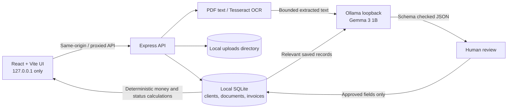

# ProofPocket AI

**Your paperwork. Your AI. Your device.**

ProofPocket is a local-first invoice and paperwork workspace for freelancers and small businesses. It combines a React interface, a local SQLite database, OCR/text extraction, and an actual Ollama model call. Document suggestions are always reviewable before a financial record is saved.

> This is an early MVP. It is not accounting, tax, legal, or payment-processing software. AI suggestions may be incorrect and require human review.

## Features

- Invoice, receipt, quotation, payment, and other document inbox with PDF and image upload.
- PDF text extraction and local OCR for PNG, JPEG, and WebP images.
- Local Ollama document classification and structured field extraction using a JSON schema.
- Review and correction before saving approved records.
- Invoice and client CRUD, deterministic overdue calculation, local dashboard and client reports.
- Record-grounded assistant: numeric totals use SQLite calculations; open-ended answers use local Ollama.
- Editable payment reminder generation; the app never sends email.
- CSV and JSON export, local deletion controls, sample data for an interactive demo.
- No telemetry and no external AI provider. The Vite dev server and API bind to loopback.

## macOS setup

### Requirements

- macOS 13 or newer.
- Node.js **20.19+** and npm.
- Ollama for AI extraction and open-ended assistant answers. The rest of the app can be explored without a model.

Install Node.js with the official installer or with Homebrew:

```bash
brew install node
node --version
```

Install Ollama from [ollama.com/download/mac](https://ollama.com/download/mac), open the app, then fetch Gemma 3 1B:

```bash
ollama pull gemma3:1b
ollama run gemma3:1b
```

Leave Ollama running in the background. In another terminal, from this project directory:

```bash
cp .env.example .env
npm install
npm run dev
```

Open [http://127.0.0.1:5173](http://127.0.0.1:5173). The API uses [http://127.0.0.1:4174](http://127.0.0.1:4174). SQLite tables are created automatically on first run under `data/`; no separate migration command is needed. The database and uploaded documents are git-ignored.

To build and run the production bundle locally:

```bash
npm run build
npm start
```

Then open [http://127.0.0.1:4174](http://127.0.0.1:4174).

## Configuration

Copy `.env.example` to `.env` before starting the API:

| Variable | Default | Meaning |
| --- | --- | --- |
| `PORT` | `4174` | Local API and production UI port |
| `OLLAMA_URL` | `http://127.0.0.1:11434` | Local Ollama only; non-loopback URLs are rejected |
| `OLLAMA_MODEL` | `gemma3:1b` | Model name that must already be installed in Ollama |
| `MAX_UPLOAD_MB` | `12` | Upload limit (hard cap 20 MB) |
| `DATA_DIR` | `./data` | Local SQLite database and uploaded source files |

When Ollama or the model is missing, the UI shows setup guidance. Upload text extraction can still be reviewed and entered manually; the app never labels manual values as AI output.

## Architecture and data flow



1. The API validates the upload size, MIME type, and file signature and saves it under a generated random name.
2. PDF text is extracted in process; supported image formats use Tesseract.js OCR. Empty/unreadable text is an error, not a successful extraction.
3. Only bounded extracted text is sent to the configured **local** Ollama service. Document text is framed as untrusted data and cannot change the system prompt.
4. The response must parse and satisfy the Zod schema. The user reviews editable values and approves before an invoice row is inserted.
5. Totals and overdue state are calculated by app code. The assistant receives only saved invoice records relevant to the query; direct numeric questions are calculated without the model.

## API overview

All API routes are local to this app; there is no arbitrary Ollama proxy.

| Method | Path | Purpose |
| --- | --- | --- |
| `GET` | `/api/health`, `/api/ai/status` | Local health and Ollama/model availability |
| `GET`, `POST`, `PATCH`, `DELETE` | `/api/invoices[/:id]` | Invoice records and status updates |
| `GET`, `POST`, `PATCH`, `DELETE` | `/api/clients[/:id]` | Client directory |
| `GET`, `POST` | `/api/documents`, `/api/documents/upload` | Inbox and OCR/AI processing |
| `POST`, `DELETE` | `/api/documents/:id/approve`, `/api/documents/:id` | Approve reviewed record or delete source |
| `GET` | `/api/dashboard`, `/api/reports/summary` | Calculated dashboard and report figures |
| `GET` | `/api/reports/export.csv`, `/api/data/export.json` | Local data exports |
| `POST` | `/api/assistant/ask`, `/api/assistant/reminder` | Record-grounded answer and editable reminder draft |
| `POST`, `DELETE` | `/api/demo/sample`, `/api/data` | Empty workspace sample seed and full local deletion |

Input is validated with Zod. SQLite access uses prepared statements. Uploads accept PDF/PNG/JPEG/WebP up to the configured limit, capped at 20 MB. Unsafe cross-origin state-changing requests are rejected. The API binds to `127.0.0.1`.

## Privacy and threat model

**What stays on this device:** SQLite records, uploaded source files, OCR/PDF extraction, and local model inference. ProofPocket adds no telemetry or analytics calls and has no cloud AI integration. The interface uses system fonts.

**What crosses a network boundary:** extracted text and relevant records are sent from the API to the Ollama URL configured on loopback. Ollama may download model files when you run `ollama pull`; normal inference is local. Tesseract.js may fetch its public English OCR language data from jsDelivr the first time image OCR runs. That request downloads a model file only; the uploaded image and its recognized text are not sent to that CDN. The app rejects non-loopback Ollama URLs.

**Limitations:** local storage is not encrypted by ProofPocket. Other users/processes with access to your Mac can read the database and files. Device encryption, OS access controls, and protected backups remain your responsibility. The app is not formally security audited or certified. Scanned PDFs are currently reported as unreadable; OCR is supported for image uploads. Currency totals are grouped in reports, and the app does not convert currencies. Passwords, bank credentials, and card details are not needed or requested.

Do not expose the API or Ollama port to the public internet. A hosted landing page can use clearly marked sample data, but real private document processing needs the user's own secured local installation. A public multi-user deployment would require authentication, tenant isolation, encryption, secure file handling, and a separate threat review.

## Tests and verification

```bash
npm test
npm run build
```

Automated tests cover overdue status, minor-unit totals and mixed-currency grouping, local SQLite schema creation, model availability, malformed model JSON, schema validation, and rejection of remote Ollama URLs. Tests mock Ollama. They do not demonstrate that an actual model is installed or that OCR works on every user's documents.

### Manual local inference checklist

1. Start Ollama, run `ollama pull gemma3:1b`, then `ollama run gemma3:1b`.
2. Start ProofPocket and confirm Settings shows the model as connected and ready.
3. Upload a readable invoice PDF or invoice screenshot. Confirm the review screen says suggestions came from local AI.
4. Compare the proposed fields with the source, correct any errors, then approve. Verify the invoice appears in the tracker and dashboard.
5. Ask the assistant which invoices are overdue. Confirm the response references saved rows. Ask for outstanding totals and confirm it is labeled as calculated.
6. Stop Ollama and refresh Settings. Confirm unavailable status is shown and an attempted AI action returns an actionable error, without a fabricated answer.
7. Export CSV, then delete the sample workspace and confirm local records are removed.

## Demo script

1. Open the empty dashboard and point out that totals are zero and no demo data is implied.
2. Load the clearly labeled sample data and show the invoice statuses and dashboard totals.
3. Open Document Inbox, upload a test invoice, review OCR text, and correct fields before saving.
4. Ask the assistant a numeric question and an overdue-invoice question.
5. Export the report and show the Settings privacy explanation.

No screenshot of the running application is included yet; capture one after launching the UI locally and add it under `docs/screenshots/` before publishing a submission.

## Open-weight AI and business model

Gemma 3 1B via Ollama is open-weight and runs on the user's computer. This reduces exposure to a hosted AI vendor, avoids per-document inference charges, and allows the user to keep client paperwork in their own local workspace. Small local models can miss fields or emit malformed output, so this product validates the schema, makes missing values explicit, and requires review.

A plausible business model is a free local core with paid setup support, business onboarding, optional team workflows, or a separately secured hosted deployment. No customer, revenue, or willingness-to-pay claim has been verified.

Compared with a closed hosted API, local inference gives the user greater control over where document text is processed and avoids usage-based API billing. Hosted models may be more capable and easier to operate; ProofPocket accepts model setup and local hardware limits in exchange for local processing and user control.

Dependency license review is summarized in [`THIRD_PARTY_NOTICES.md`](./THIRD_PARTY_NOTICES.md). The local challenge submission draft is in [`CHALLENGE_SUBMISSION.md`](./CHALLENGE_SUBMISSION.md).

## Hacktoberfest Week 2 submission draft

**Title:** ProofPocket AI: a private paperwork assistant for freelancers

**What I built:** ProofPocket AI is a local-first invoice and document workspace. It extracts text from PDFs and images, uses Gemma 3 1B through Ollama for structured suggestions, and asks the user to review every field before saving. It tracks invoices, payment status, client balances, and due dates; exports reports; and answers questions grounded in saved local records.

**Problem and who could pay:** Independent designers, developers, consultants, and small businesses spend time sorting paperwork and following up on unpaid invoices. A freelancer or small business could pay for managed setup, support, or team workflows. No customers or payment have been collected or claimed.

**How it works:** React/Vite talks to a loopback Express API. SQLite stores clients, source-document metadata, and approved invoices. PDF text extraction and Tesseract.js run locally. The API sends bounded document text to the configured local Ollama service and validates the returned JSON before presenting suggestions. Code performs monetary totals and overdue calculations deterministically. Email reminders are editable drafts only.

**Open-weight model and tools:** Gemma 3 1B via Ollama; React, Express, SQLite (`better-sqlite3`), Zod, Multer, PDF parsing, Tesseract.js, Recharts, and Lucide React.

**Why open innovation matters:** Client invoices contain commercially sensitive details. Local inference avoids sending documents to a third-party AI API and does not create per-request model charges. Users can choose their local model and retain their data on their computer. The trade-off is model quality and setup responsibility; model output is not trusted as verified financial information.

**Actual test results:** See `CHALLENGE_SUBMISSION.md` for the checks run on this implementation. A synthetic invoice was manually sent through the local extraction adapter using the installed Gemma 3 4B model and returned the expected fields. The app's default Gemma 3 1B is not installed here, and the complete browser upload-to-review flow still needs a manual run.

**Demo:** `[add a real demo link or local demo instructions]`
**Repository:** `[add the public repository link]`
**User feedback:** `[add real feedback, or state that no external user feedback has been collected]`

Required challenge tag: `#hf26challenge`. The Week 2 Side Hustle brief asks for an open-weight/open-source AI project that addresses a real task someone could pay for, explains why open innovation matters, and demonstrates the working product. Submission deadline listed by the event is October 18, 2026 at 11:59 PM PDT.

## Screenshots and release checklist

- [ ] Capture the real dashboard and invoice review screen after a local run; add `docs/screenshots/dashboard.png` and `docs/screenshots/review.png`.
- [x] Exercise local model extraction using the installed Gemma 3 4B model. The default Gemma 3 1B and full browser upload flow still need a manual run.
- [ ] Run automated tests and build; replace the submission's pending test-results note with actual output.
- [ ] Add repository and demo links and collect genuine user feedback if available.
- [x] Review direct dependency license metadata; see `THIRD_PARTY_NOTICES.md`.
- [ ] Keep `.env`, `data/`, source documents, and personal exports out of version control.
